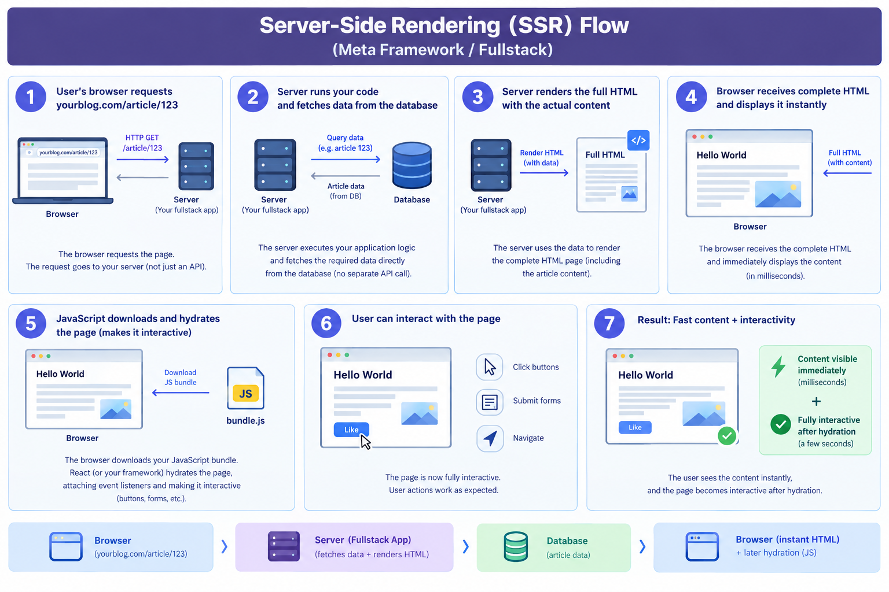
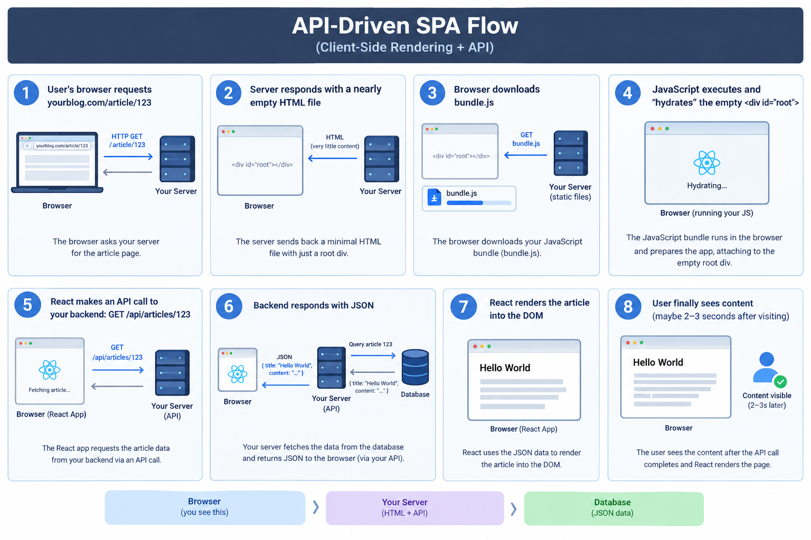
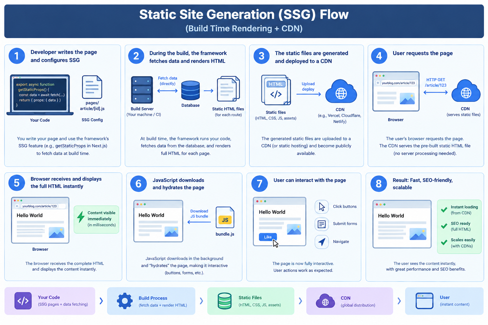

A meta-framework sits on top of a UI library (React / Vue / Svelte) to make it a complete application framework.

It adds on top of the UI lib:
- file-based routing
- server-side rendering
- static generation
- API routes
- middleware
- deployment adapters

# How it works

Routing defines URLs; data-loading defines *when* data is fetched: server, client, or both.

**SSR**: server fetches data and renders full HTML on the fly per request.



**CSR / SPA**: server sends shell + JS; client renders.



**SSG**: framework pre-renders pages to static HTML at build time.



**ISR**: like SSG, but after N seconds the next request triggers a background re-render with fresh data.
**Islands / partial hydration** (Astro) vs **Server + Client components** (Next.js): both ship less JS, but islands hydrate isolated widgets on a static page while Next.js splits one React tree into server-run and browser-run components.

> Here you write code in the same project, but some code runs on the server and some runs in the browser. The bridge is **hydration**: server HTML + client JS taking over interactivity.

```
Most production apps use meta-frameworks because they mix modes per route:

    A statically generated marketing page (/about)
    A server-rendered product page (/products/123)
    A client-side interactive dashboard (/dashboard)
    All in the same project, deployed to the same platform (Vercel/Netlify)
```
